<div align="center">

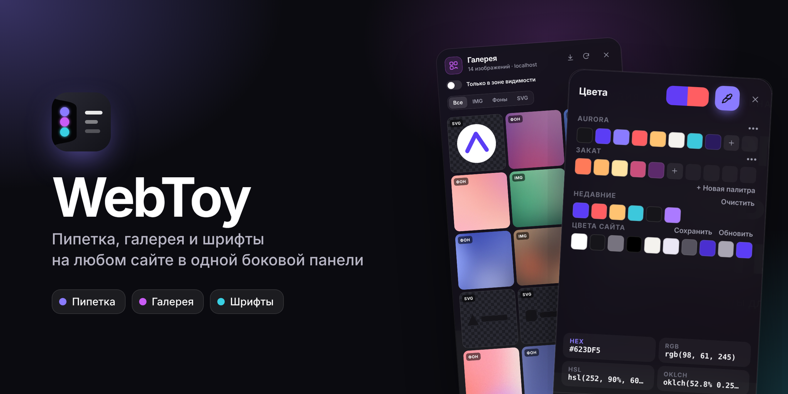

# WebToy

**Пипетка, галерея изображений и шрифты на любом сайте - в одной изогнутой боковой панели.**

[](https://developer.chrome.com/docs/extensions/develop/migrate/what-is-mv3)
[](#установка)
[](CHANGELOG.md)
[](LICENSE)
[](#разработка)

[Возможности](#возможности) · [Установка](#установка) · [Горячие клавиши](#горячие-клавиши) · [Настройки](#настройки) · [Как это устроено](#как-это-устроено) · [Разработка](#разработка)

</div>

---

WebToy - браузерное расширение для дизайнеров и фронтенд-разработчиков. На каждой странице у края экрана появляется аккуратная «жидкая» панель с тремя инструментами: взять цвет с экрана и поиграть с палитрой, посмотреть и скачать все изображения сайта, найти и забрать все его шрифты.

<p align="center">
  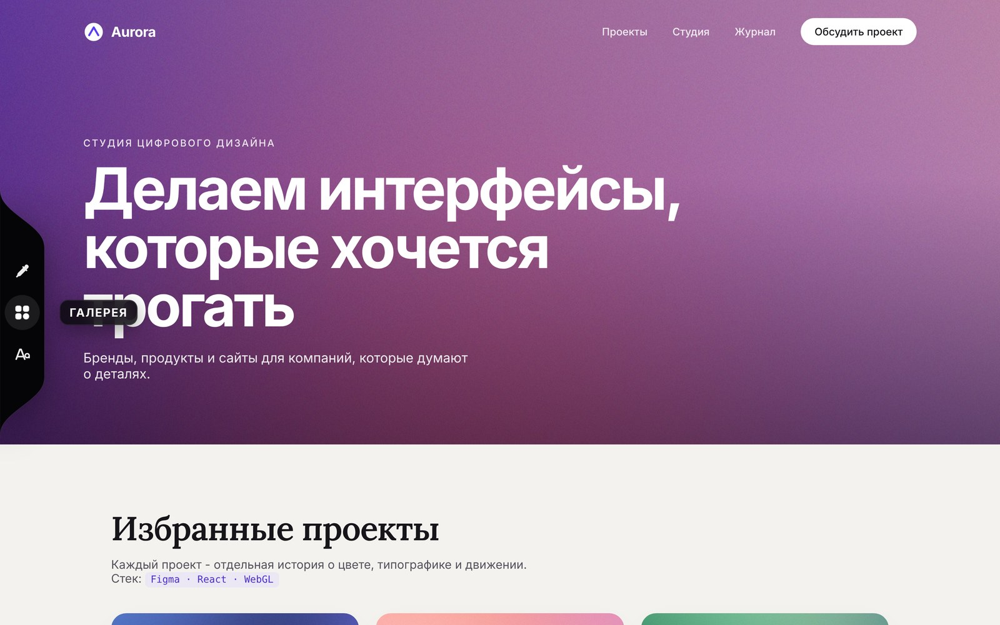
</p>

Панель свёрнута в тонкую полоску и раскрывается при наведении. Её можно перетащить выше или ниже, поставить слева или справа и полностью выключить на отдельных сайтах.

## Возможности

### 🎨 Пипетка и палитра

Берёт цвет с любой точки экрана (включая картинки, видео и canvas) и сразу копирует его в буфер. Панель цветов сделана по мотивам Procreate:

| Вкладка | Что внутри |
|---|---|
| **Диск** | Кольцо тона и круглое поле насыщенности/яркости |
| **Классика** | Квадрат насыщенности/яркости, ползунки тона и прозрачности |
| **Гармония** | Цветовой круг с подбором пар: комплементарная, сплит-комплементарная, аналоговая, триада, тетрада |
| **Значения** | Ползунки HSB, RGB и альфа, поле HEX, проверка контраста WCAG на белом и чёрном |
| **Палитры** | Свои палитры, история недавних цветов и автоматическая палитра текущего сайта |

Форматы копирования: **HEX, RGB, HSL, OKLCH**. Палитру можно скопировать как CSS-переменные или JSON и скачать файлом.

<p align="center">
  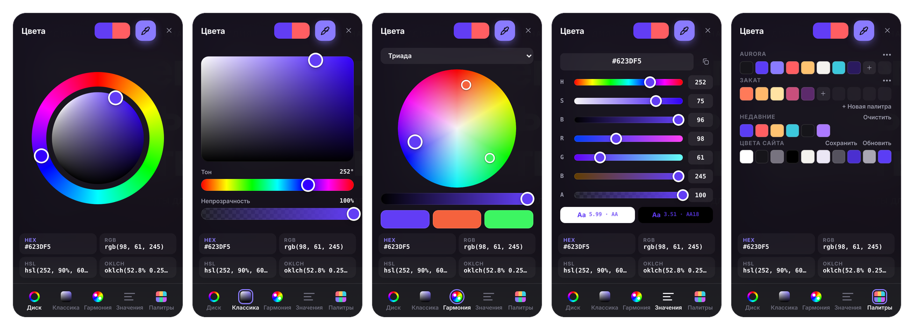
</p>

<p align="center">
  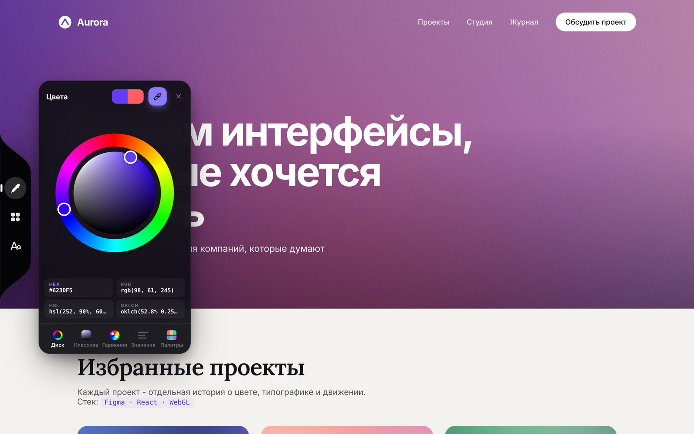
</p>

### 🖼 Галерея

Сайдбар слева поверх сайта со всеми изображениями страницы в три колонки. WebToy находит не только обычные картинки:

- `` и `<picture>` (с учётом `srcset` и ленивой загрузки через `data-src`);
- фоновые изображения CSS, в том числе у `::before` и `::after`, `border-image`, `mask-image`;
- обложки `<video poster>`, inline-SVG (вместе со спрайтами `<use>`), `<canvas>`;
- картинки Open Graph и иконки сайта.

Сверху переключатель **«Только в зоне видимости»**: галерея показывает лишь то, что сейчас на экране, и обновляется при прокрутке. Есть фильтры (все, IMG, фоны, SVG), просмотр с листанием стрелками, скачивание по одной или всех сразу, копирование ссылки и кнопка «показать на странице», которая подсвечивает элемент.

<table>
  <tr>
    <td width="50%">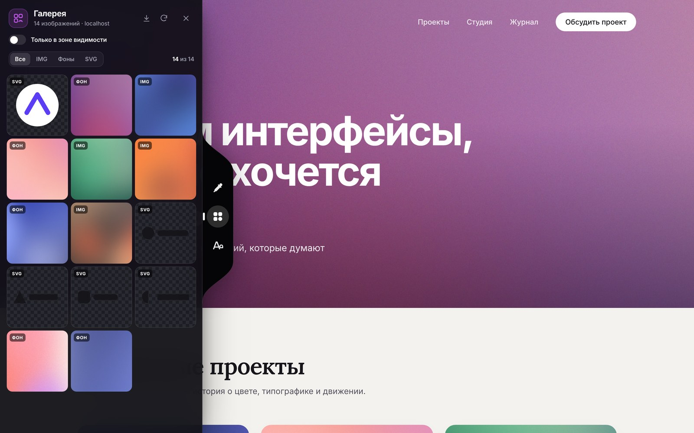</td>
    <td width="50%">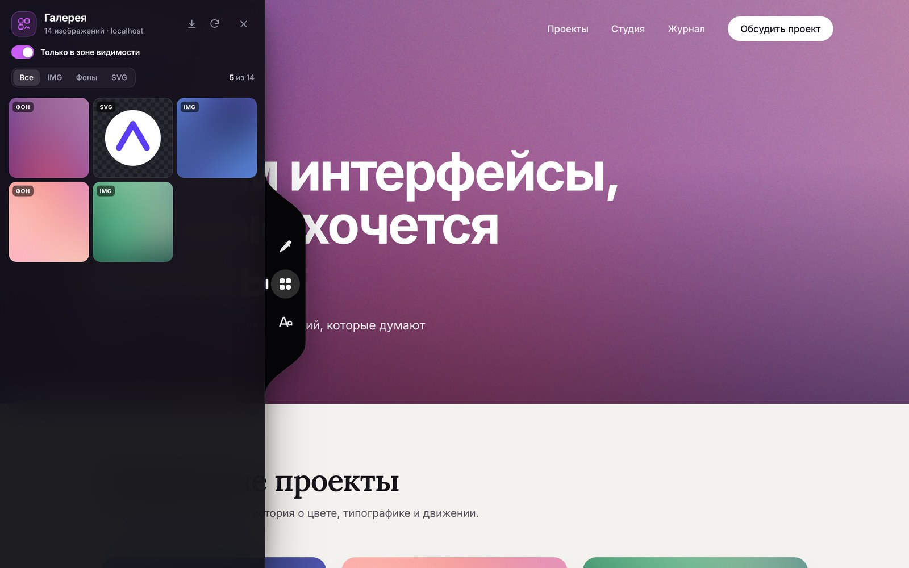</td>
  </tr>
  <tr>
    <td align="center"><sub>Все изображения страницы</sub></td>
    <td align="center"><sub>Только то, что сейчас на экране</sub></td>
  </tr>
</table>

<p align="center">
  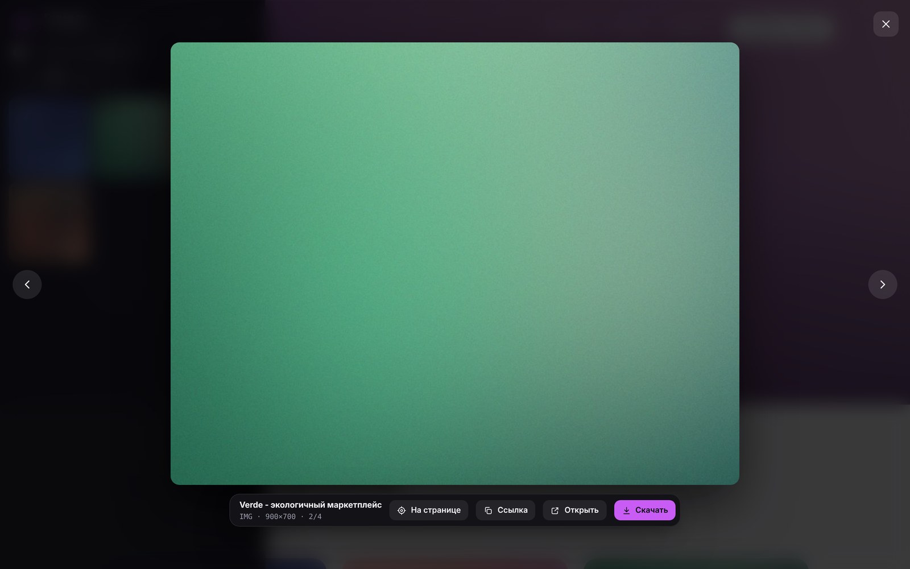
</p>

### 🔤 Шрифты

Сайдбар слева со списком всех шрифтов, которые реально используются на странице. Сверху поле с текстом (по умолчанию «Здравствуй, Friend!») и ползунок размера: каждый шрифт в списке сразу показывает этот текст.

- определяет, каким шрифтом на самом деле отрисован текст, а не просто первое имя в `font-family`;
- показывает начертания, количество элементов, размеры и источник: веб-шрифт, Google Fonts, локальный или системный;
- подсвечивает на странице все элементы с этим шрифтом;
- **скачать файлом**: исходные файлы шрифта с сайта, а для установленных в системе шрифтов - с Google Fonts;
- **подключить через CDN**: готовый код для Google Fonts (`<link>` или `@import`), Fontsource через jsDelivr, `npm i @fontsource/...` или `@font-face` с адресами самого сайта.

<p align="center">
  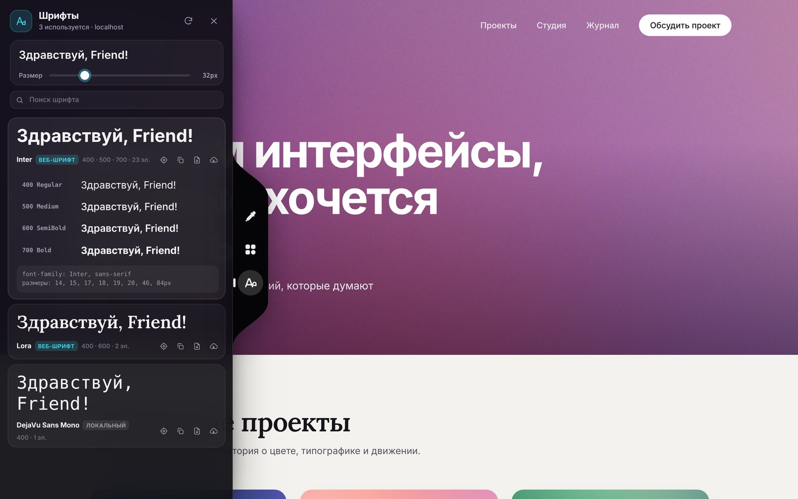
</p>

### 🌗 Светлая и тёмная тема

Сайдбары и палитра бывают тёмными, светлыми или следуют теме системы.

<p align="center">
  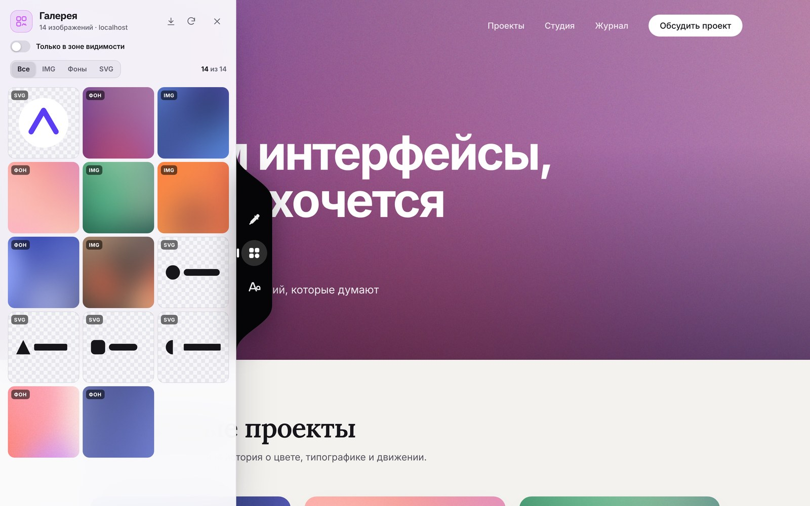
</p>

## Установка

### Из исходников (режим разработчика)

1. Скачайте репозиторий: **Code → Download ZIP** и распакуйте, или клонируйте:
   ```bash
   git clone https://github.com/A01L/WebToy.git
   ```
2. Откройте страницу расширений:
   - Chrome: `chrome://extensions`
   - Edge: `edge://extensions`
   - Яндекс Браузер: `browser://extensions`
   - Opera: `opera://extensions`
   - Brave: `brave://extensions`
3. Включите **Режим разработчика**.
4. Нажмите **Загрузить распакованное** и выберите папку `WebToy` (ту, где лежит `manifest.json`).
5. Обновите открытые вкладки (F5), чтобы панель появилась на уже загруженных страницах.

### Из релиза

На странице [Releases](https://github.com/A01L/WebToy/releases) лежит готовый архив `webtoy-<версия>.zip`. Распакуйте его и выполните шаги 2-5 выше.

## Горячие клавиши

| Сочетание | Действие |
|---|---|
| `Alt+Shift+W` | Показать или скрыть навигацию |
| `Alt+Shift+C` | Открыть пипетку |
| `Alt+Shift+G` | Открыть галерею |
| `Alt+Shift+F` | Открыть шрифты |
| `Esc` | Закрыть меню, просмотр, палитру или сайдбар |
| `←` `→` | Листать изображения в просмотре |

Если браузер не назначил сочетание из-за конфликта с другим расширением, задайте своё на странице `chrome://extensions/shortcuts`.

## Настройки

Меню расширения на панели браузера: главный переключатель навигации, отключение для текущего сайта и быстрый запуск инструментов.

<p align="center">
  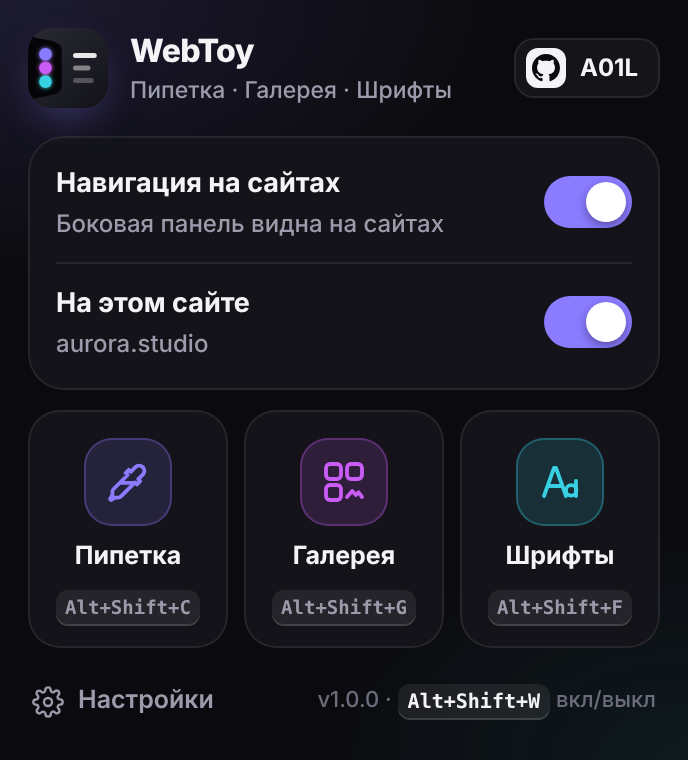
</p>

На странице настроек можно выбрать:

- сторону экрана (слева или справа) и положение панели по высоте;
- сворачивание в тонкую полоску и подписи при наведении;
- тему панелей: тёмная, светлая или как в системе;
- формат, в котором пипетка копирует цвет;
- текст для превью шрифтов по умолчанию;
- список сайтов, где навигация выключена;
- экспорт и очистку сохранённых палитр.

<details>
<summary>Скриншот страницы настроек</summary>
<br>
<p align="center">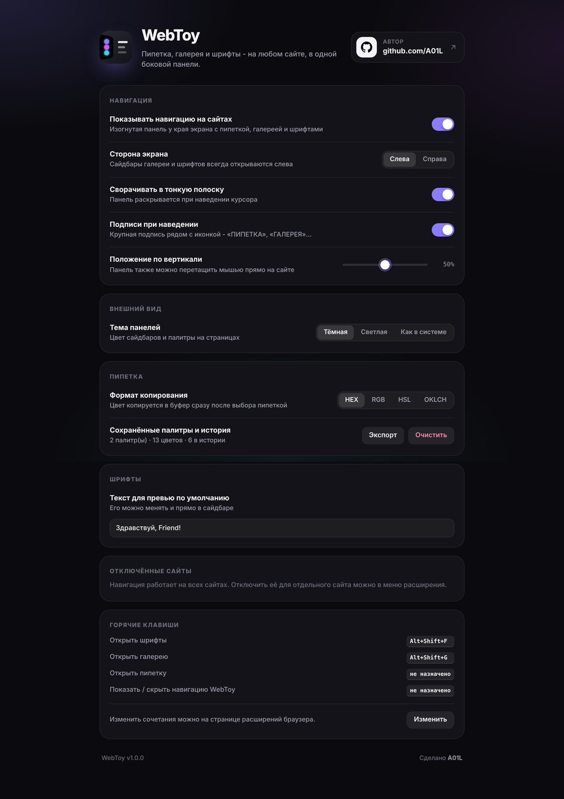</p>
</details>

## Как это устроено

- **Изоляция от сайта.** Весь интерфейс живёт в закрытом Shadow DOM, поэтому стили сайта не ломают панель, а стили панели не задевают сайт.
- **Всегда поверх.** Панель выводится в верхний слой браузера (Popover API, top layer), поэтому её не перекрывают шапки и меню с любым `z-index`, как, например, на YouTube.
- **Пипетка** использует встроенный в браузер `EyeDropper`. Если его нет, включается запасной режим: снимок вкладки и лупа с увеличением пикселей.
- **Шрифты.** Расширение читает правила `@font-face` из стилей страницы. Стили с других доменов недоступны странице напрямую, поэтому их загружает фоновый скрипт расширения. Установлен ли шрифт в системе, определяется по замеру ширины текста на canvas.
- **Без зависимостей и сборки.** Чистый JavaScript, CSS и HTML, Manifest V3.

### Разрешения

| Разрешение | Зачем |
|---|---|
| `<all_urls>` | Показывать панель на любом сайте, читать стили и шрифты с других доменов, делать снимок вкладки для запасной пипетки |
| `storage` | Хранить настройки, палитры и историю цветов |
| `downloads` | Скачивать изображения и файлы шрифтов |
| `clipboardWrite` | Копировать цвета, ссылки и CSS |
| `activeTab` | Работать с текущей вкладкой из меню расширения |

### Приватность

WebToy ничего не собирает и никуда не отправляет. Настройки и палитры хранятся в вашем браузере. Сетевые запросы делаются только по вашему действию: загрузка стилей и шрифтов текущего сайта, а при нажатии кнопки CDN - проверка наличия шрифта на `fonts.googleapis.com` и `cdn.jsdelivr.net`.

## Структура проекта

```
WebToy/
├── manifest.json          # Manifest V3: права, скрипты, горячие клавиши
├── icons/                 # Иконки расширения (16-128 px) и logo.svg
├── src/
│   ├── background.js      # Service worker: загрузки, запросы, снимок вкладки, хоткеи
│   ├── ui.css             # Общие стили popup и страницы настроек
│   ├── content/           # Всё, что работает на страницах сайтов
│   │   ├── core.js        # Общие помощники: DOM, иконки, буфер обмена, тосты, меню
│   │   ├── color.js       # Цветовая математика: HSV, HSL, HEX, OKLCH, контраст WCAG
│   │   ├── styles.js      # Стили интерфейса внутри Shadow DOM
│   │   ├── nav.js         # Изогнутая боковая навигация
│   │   ├── picker.js      # Пипетка и панель цветов
│   │   ├── gallery.js     # Галерея изображений и просмотр
│   │   ├── fonts.js       # Поиск шрифтов, превью, скачивание и CDN
│   │   └── main.js        # Запуск: контейнер, сайдбары, маршрутизация инструментов
│   ├── popup/             # Меню расширения на панели браузера
│   └── options/           # Страница настроек
└── docs/screenshots/      # Скриншоты для README
```

## Разработка

Сборка не нужна: правите файлы, затем на странице `chrome://extensions` нажимаете ↻ у WebToy и обновляете вкладку с сайтом.

Полезно знать:

- контент-скрипты подключаются в порядке, указанном в `manifest.json`, и делят общий объект `window.WT`;
- новый инструмент добавляется в `TOOLS` в `nav.js` и, если ему нужен сайдбар, в `TOOL_META` в `main.js` с методами `mount()` и `unmount()`;
- релиз собирается автоматически: создайте тег `v1.0.1`, и GitHub Actions выложит zip-архив в Releases.

```bash
git tag v1.0.1
git push origin v1.0.1
```

## Совместимость

Нужен браузер на Chromium версии 114 или новее: Chrome, Edge, Яндекс Браузер, Opera, Brave и другие. Firefox и Safari пока не поддерживаются.

На служебных страницах браузера (`chrome://`, магазин расширений) расширения не работают - это ограничение браузера.

## Автор

**A01L** - [github.com/A01L](https://github.com/A01L)

Нашли ошибку или есть идея? Создайте [issue](https://github.com/A01L/WebToy/issues).

## Лицензия

[MIT](LICENSE) © 2026 A01L
